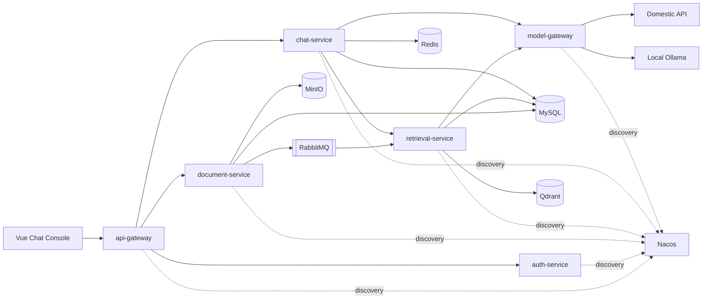
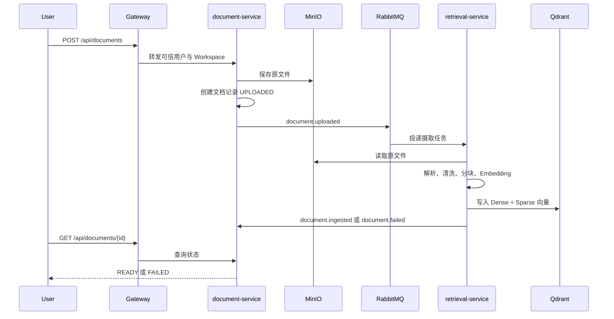
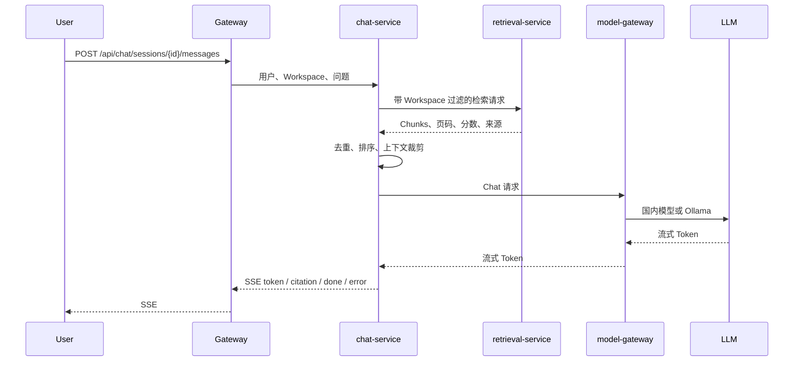

# AI Knowledge Platform 技术设计

## 项目定位

项目是一个多 Workspace 的企业知识库。用户可以上传文档、等待异步摄取，然后围绕文档进行带引用的流式问答。

业务只保留知识库主场景。技术展示重点是微服务边界、异步任务、混合检索、RAG、租户隔离、容错、评测和部署。

## 技术栈

- Java 17
- Spring Boot 3.5.x
- Spring Cloud 2025.0.x
- Spring Cloud Alibaba 2025.0.0.0
- Spring AI 1.1.x
- MySQL 8
- Redis 7
- RabbitMQ
- Qdrant 1.20
- MinIO
- Nacos
- Docker Compose
- GitHub Actions
- Vue 3 + Vite

所有版本必须通过 BOM 和父 POM 锁定。Spring Boot、Spring Cloud、Spring Cloud Alibaba 和 Spring AI 的兼容组合只允许在一处维护。

## 服务边界

### api-gateway

- 接收所有公网请求。
- 校验 JWT 并生成可信身份上下文。
- 注入或透传 `X-Request-Id`。
- 按用户、IP、Workspace 配置限流。
- 支持 SSE 长连接。
- 路由到认证、文档和聊天服务。

### auth-service

- 用户、Workspace 和成员关系。
- `OWNER`、`EDITOR`、`VIEWER` 权限。
- 登录、访问令牌和刷新令牌。
- Workspace 上下文解析。

### document-service

- 接收 PDF、Markdown 和 TXT。
- 校验类型、大小和 Workspace 权限。
- 将原文件写入 MinIO。
- 保存文档元数据和摄取状态。
- 发布 `document.uploaded` 事件。
- 提供文档状态查询。

### retrieval-service

- 消费文档摄取事件。
- 解析、清洗和分块。
- 调用固定 Embedding 模型。
- 写入 Dense 和 BM25 向量。
- 提供带 Workspace 过滤的混合检索。
- 发布 `document.ingested` 或 `document.failed`。

### chat-service

- 创建会话和保存消息。
- 调用检索服务获取上下文。
- 通过 Spring AI Advisor 组织 RAG Prompt。
- 通过模型网关生成非流式或 SSE 回答。
- 保存引用、模型、Token、Prompt 版本和耗时。

### model-gateway

- 统一 Chat 和 Embedding 请求/响应。
- 国内模型 API 为主通道。
- Ollama 为本地聊天降级。
- 统一处理超时、重试、熔断和错误。
- 统计 Token、延迟和 Provider。
- 不在日志中输出密钥或完整敏感 Prompt。

## 架构图



## 文档摄取流程



## 问答流程



## 对外接口

### 认证

`POST /api/auth/login`

```json
{
  "email": "demo@example.com",
  "password": "***"
}
```

`POST /api/auth/refresh`

### 文档

`POST /api/documents`

- `multipart/form-data`
- 字段：`file`
- 返回：`documentId`、`status`

`GET /api/documents/{documentId}`

返回文档元数据、状态、错误摘要和更新时间。调用者必须属于该 Workspace。

### 会话

`POST /api/chat/sessions`

创建当前用户在当前 Workspace 下的会话。

`POST /api/chat/sessions/{sessionId}/messages`

- Content-Type：`application/json`
- Accept：`text/event-stream`
- 请求：`{ "content": "问题" }`
- SSE 事件：
  - `token`：回答片段。
  - `citation`：文档、页码、片段和分数。
  - `done`：消息 ID、模型和耗时。
  - `error`：统一错误体。

`GET /api/chat/sessions/{sessionId}/messages`

分页返回会话历史。

## 内部接口

### Chat

`POST /internal/models/chat`

统一字段：

- `requestId`
- `purpose`
- `messages`
- `model`
- `temperature`
- `maxTokens`
- `stream`

响应必须包含：

- `provider`
- `model`
- `content` 或流式片段
- `usage.promptTokens`
- `usage.completionTokens`
- `latencyMs`

### Embedding

`POST /internal/models/embeddings`

响应必须包含固定 `embeddingModel`、维度和向量。服务启动时校验集合维度，不匹配则拒绝写入。

### Retrieval

`POST /internal/retrieval/search`

请求：

- `workspaceId`
- `query`
- `topK`
- `documentIds`

响应：

- `chunkId`
- `documentId`
- `documentName`
- `page`
- `content`
- `denseScore`
- `sparseScore`
- `fusedScore`

## 数据所有权

| 存储 | 数据 |
| --- | --- |
| MySQL | 用户、Workspace、角色、文档元数据、Chunk 元数据、会话、消息、Prompt、任务、评测 |
| MinIO | 原始文档 |
| Qdrant | Dense/Sparse 向量和过滤 Payload |
| Redis | 限流、短期缓存、会话辅助状态 |
| RabbitMQ | 文档摄取、失败重试和死信 |

Qdrant Payload 至少包含 `workspaceId`、`documentId`、`chunkId`、`visibility` 和 `embeddingVersion`。任何检索必须带 Workspace 过滤。

## 核心状态机

```text
UPLOADED -> PARSING -> CHUNKING -> EMBEDDING -> READY
     |          |           |            |
     +----------+-----------+------------+-> FAILED
```

状态只能向后流转；`READY` 和 `FAILED` 是终止状态。重摄入应创建新任务版本，不修改历史向量。

## 统一 MQ 事件

```json
{
  "eventId": "uuid",
  "type": "document.uploaded",
  "version": 1,
  "occurredAt": "2026-11-10T12:00:00Z",
  "aggregateId": "document-id",
  "traceId": "request-id",
  "payload": {}
}
```

消费端必须以 `eventId` 去重。消息失败进入重试队列，超过次数进入死信队列。

## 安全边界

- JWT 在 Gateway 校验，下游仍执行权限检查。
- Workspace 只能来自可信身份上下文。
- 模型 Key 只通过环境变量或 GitHub Secrets 传入。
- 上传文件限制扩展名、MIME、大小和文件名。
- 解析器在独立任务中执行并设置资源上限。
- 模型没有任意命令执行工具。
- 文档内容被视为不可信输入，Prompt 明确区分系统指令和检索片段。

## 2C4G 部署策略

- 公网只运行单实例六服务和单节点基础设施。
- MySQL、Redis、Qdrant、RabbitMQ、Nacos 设置内存上限。
- JVM 使用显式 `-Xms`/`-Xmx`，默认不超过 192 MB。
- 配置 2–4 GB Swap 防止短时 OOM。
- 公网不运行 Ollama、Prometheus、Grafana。
- 主要使用国内 API，按需启停服务器。
- 本地完整环境承担压测、链路追踪和模型降级演示。

## 已知取舍

- 六个服务增加部署成本，不追求展示服务数量，而展示明确边界。
- 2C4G 无法支持高并发和多副本，因此以本地压测和公网功能演示分工。
- Embedding 模型与向量维度强绑定，切换时必须全量重建索引。
- Ollama 只作为聊天降级，不作为公网 Embedding Provider。
